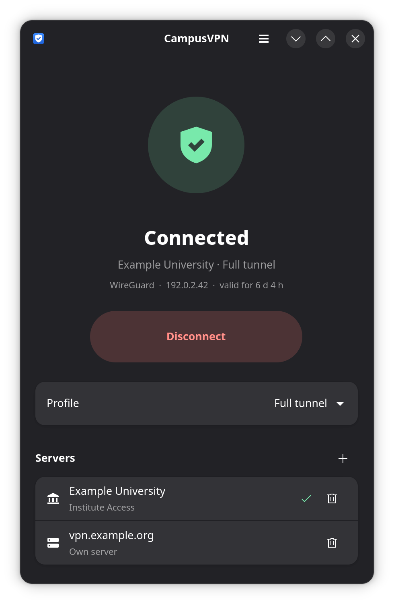

# CampusVPN

A lightweight Linux VPN client with a system tray and auto-connect, compatible with
[eduVPN](https://www.eduvpn.org/) and Let's Connect! VPN servers. Written in Rust with GTK 4
and libadwaita.

<p align="center"></p>

> **Not affiliated with eduVPN, GÉANT or SURF.** This is an independent client. For the
> official eduVPN app see [codeberg.org/eduVPN/linux-app](https://codeberg.org/eduVPN/linux-app).
> CampusVPN does not connect to Cisco AnyConnect or other "campus VPN" services.

Formerly called eduvpn-rs. Settings and the autostart entry are moved over on the first start,
and the install script removes the old install.

## Features

- **System tray**: status icon with connect/disconnect, server switching, show and quit.
  Closing the window keeps the app running in the tray.
- **Auto-connect** to the last used server on start, once the network is up.
- **Start on login**, optionally hidden in the tray.
- WireGuard, OpenVPN and WireGuard over TCP (ProxyGuard).
- Profile and Secure Internet location switching, session renewal.

The protocol work (server discovery, OAuth login, token refresh, fetching VPN configs) is done
by the [eduvpn-common](https://codeberg.org/eduVPN/eduvpn-common) library, loaded at
runtime, as the official client does. The VPN itself is set up through NetworkManager.

## Install

### Quick install (any distro, x86_64)

```sh
curl -fsSL https://raw.githubusercontent.com/Avanatiker/campusvpn/master/install.sh | sh
```

Installs the latest [release](https://github.com/Avanatiker/campusvpn/releases) into
`~/.local` (no root needed). The release includes the eduvpn-common library. You need
NetworkManager, GTK 4.14+ and libadwaita 1.5+ (Arch, Fedora 40+, Debian 13, Ubuntu 24.04 or
newer), plus `networkmanager-openvpn` for OpenVPN servers. Run the same command to update;
uninstall with `curl -fsSL https://raw.githubusercontent.com/Avanatiker/campusvpn/master/install.sh | sh -s -- --uninstall`.

### Arch Linux (AUR)

**Pending:** the AUR package is not published yet, because AUR account registration is
currently closed. Once it is available:

```sh
yay -S campusvpn
```

Until then, build the package from [`pkg/aur/PKGBUILD`](pkg/aur/PKGBUILD) with `makepkg -si`
(after a release is tagged), or install from source as below. The package builds
eduvpn-common itself; no Python is needed.

### From source

Requirements:

- Rust 1.92+, GTK 4.14+, libadwaita 1.5+
- NetworkManager, plus `networkmanager-openvpn` for OpenVPN servers
- `libeduvpn_common-5.x.so`. Build it from
  [eduvpn-common](https://codeberg.org/eduVPN/eduvpn-common) with `make` (needs Go), or use
  the one shipped with the `python-eduvpn_common` package. It is found in `/usr/lib/campusvpn/`,
  the usual library dirs, Python site-packages, `~/.local/lib/campusvpn/` or next to the
  binary. Override with `EDUVPN_COMMON_LIB=/path/to/libeduvpn_common-5.x.so`.

```sh
make install           # installs to ~/.local (binary, desktop entry, icon)
campusvpn              # or start "CampusVPN" from the app menu
```

Enable "Start on login" in Settings for autostart.

### Desktop notes

- Tokens are stored in the Secret Service (KWallet, GNOME Keyring). Without one they are
  written to `~/.config/eduvpn/keys` with mode 600.
- The tray uses StatusNotifierItem: works on KDE, Xfce, Cinnamon, etc. On GNOME install the
  AppIndicator extension. Without a tray, closing the window quits the app.

## Compatibility with the official eduVPN client

CampusVPN uses the same config directory (`~/.config/eduvpn`), OAuth client ID and keyring
entries as the official Linux client, so servers and logins carry over in both directions.
Don't run both at the same time.

## Usage

```
campusvpn              open the window
campusvpn --hidden     start in the tray only
RUST_LOG=debug campusvpn
```

## Development

```sh
cargo test                 # unit tests
cargo test -- --ignored    # adds (never activates) dummy WireGuard/OpenVPN connections
                           # in NetworkManager and removes them again
cargo run --features demo  # UI with made-up data, for screenshots
```

## License

GPL-3.0-or-later. Parts of the connection logic follow the official eduVPN Linux client
(GPL-3.0-or-later). eduvpn-common, built into the AUR package, is MIT licensed.
eduVPN and Let's Connect! are names of their respective owners and are used here only to
describe compatibility.
